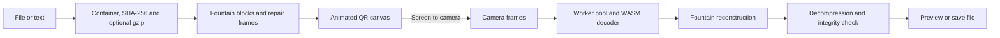

# QRtransfer v2 — technical report

QRtransfer 2.0.0 is an offline file-transfer application with one shared web
implementation, a Java Android wrapper, and an Electron desktop wrapper. A sender
displays animated QR codes; a receiver reconstructs their contents through its
camera. The transfer needs no server or network connection between devices.

## Stack and responsibilities

| Layer | Technology in this build | Purpose |
| --- | --- | --- |
| Interface | HTML, CSS, TypeScript 5.9.3 | Home, send and receive pages; ordinary DOM controls without a UI framework |
| Web build | Vite 6.4.3, Rollup through Vite | Bundles pages, styles, workers and WASM |
| QR generation | qrcode 1.5.4, Canvas 2D | Draws one, two, four or six QR codes per frame |
| Transfer format | Custom TypeScript protocol and fountain coding | File metadata, systematic data blocks and XOR repair frames tolerate missed frames |
| Integrity / compression | Web Crypto SHA-256, CompressionStream / DecompressionStream | Verifies the reconstructed file and optionally uses gzip |
| QR scanning | decimen-codec, WebAssembly, zxing-cpp, Emscripten glue | QR-only decoder with full-frame acquisition and tracked-code decoding |
| Camera / scheduling | getUserMedia, device enumeration, animation/video-frame callbacks | Captures frames, switches cameras and schedules display/capture work |
| Decode concurrency | Web Workers, OffscreenCanvas / transferable pixel buffers | Keeps decoding off the interface thread and bounds in-flight work |
| Offline web app | vite-plugin-pwa 1.3.0, Workbox, service worker, Cache API | Caches app pages and decoding assets after the first online visit |
| Single-file support | vite-plugin-singlefile 2.3.3 | Existing standalone build path; not rebuilt for this v2 delivery |
| Android | Java 17, Android Gradle Plugin 8.13.0, Gradle 8.13 | APK wrapper, permissions, file picking/saving and billing bridge |
| Android UI container | AndroidX Activity 1.9.3, WebKit 1.12.1, WebViewAssetLoader | Runs bundled pages with a secure origin and compatible back navigation |
| Android payments | Google Play Billing 8.3.0 | Existing subscription integration; live products and verification configuration remain external setup |
| Desktop | Electron 45.1.0 | Bundles Chromium/Node runtime and the web app for Mac and Windows |
| Installers | electron-builder 26.0.12, NSIS, DMG | Windows x64 EXE installer and universal Intel/Apple Silicon Mac disk image |
| Automation | Node.js 24+ / npm, GitHub Actions | Builds and packages all editions |
| Assets | Supplied JPEG logo, Pillow-generated PNG/ICO/ICNS | Shared branding and native launcher icons |
| Tests | Node test runner, Playwright/Chromium smoke checks | Protocol, access rules, UI behavior, WASM startup and offline loading |

Versions were checked against installed packages and project configuration.
The local Node executable is 26.13.0; CI requests Node 24. Kotlin BOM 1.8.22
aligns transitive Android libraries; the application wrapper itself uses Java.

## Transfer flow

The receiver can join a running stream and recover despite missing frames.
Busy decode workers cause frames to be dropped instead of queued without limit.
The scanner reuses tracked QR positions and falls back to full acquisition when
tracking fails. These algorithms are unchanged in v2; their source hashes were
compared with the pre-v2 files. No scanning-speed improvement is claimed from
these UI and packaging changes. Integrity checks detect corruption; transfers
are not encrypted.

## v2 features

The plans dialog accepts **88888888**. Successful entry enables all existing Pro
features, including six-code sending at up to 60 fps, animation exports and ad
removal. Receiving was already unrestricted. Unlock state is stored per
app/browser origin under `qrtransfer:feature-unlock`; the value is an entitlement
marker rather than the entered digits. It survives navigation and restarts,
and a free-plan billing refresh does not override it. If storage is blocked,
the unlock works for the current session and the dialog explains the limitation.

This is an offline shared code, not a globally consumable voucher. The same code
can unlock another installation. Clearing app/browser data resets it. Validation
ships in the client, so it is not a secure paid licensing service. There is no
server tracking redemption or synchronizing it between devices. Redeeming a
code does not cancel an existing Play subscription.

Free users see a dismissible ad placeholder after three qualifying transfers
and at least five minutes since the previous ad. A session qualifies when a
receive completes or it lasts at least 15 seconds. The popup closes after 20
seconds, stays out of active transfers and open plan dialogs, and is disabled
for paid/code-unlocked access. No ad network or tracking SDK is connected.

Only English, French, Simplified Chinese and Japanese are imported into the app.
The web bundle has 12 HTML pages instead of 36. Retired catalogs remain in the
source tree for reference but are excluded from runtime bundles. Translated
pages no longer render the review notice.

The home share dialog and QR use `https://qrtransfer1.netlify.app/`; the sender
shares `https://qrtransfer1.netlify.app/receive/`. Copy, native sharing and QR
rendering use the same field. Updating the code does not deploy the website.

Header navigation now uses centered flex alignment. The visible upstream source,
upstream releases and named copyright footer elements were removed. LICENSE,
NOTICE, codec notices and build-license comments are retained, along with the
corresponding-source download.

## Packaging and efficiency

The web package is a static HTTPS site suitable for Netlify. There is no database,
API server or authentication service. Preferences and unlock state are local;
the service worker supplies offline assets after installation.

Android bundles compiled pages in its APK, targets SDK 36 and supports Android
7.0+ (minSdk 24) with a sufficiently recent WebView (119+). Its generated asset
directory is cleared before copying a new build, so old language chunks do not
accumulate in the APK.

Desktop loads bundled files through `qrtransfer://app/`. Renderer sandboxing
and context isolation are enabled; Node.js is not exposed to the pages. Camera
permission, save dialogs and keeping the display awake use native APIs. It works
offline on first launch. Electron's bundled runtime accounts for most of the
roughly 120 MB Windows installer, so translation trimming has a larger proportional
effect on the web payload than on the installer.

Workbox precache decreased from **2151.84 KiB to 1782.16 KiB**: **369.68 KiB
(about 17%) smaller**, despite the added unlock/ad interface. This compares this
workspace's v1/v2 production builds and excludes the source ZIP.

## Verification and delivery

- 148 application tests and six desktop policy tests pass.
- Web, Android asset and desktop asset builds pass TypeScript and bundle checks.
- Browser checks pass for four locales, clean footers, header alignment at a
  375-pixel viewport, sharing-link/QR rendering, ad appearance/dismissal after a
  qualifying transfer, invalid/valid codes, reload/offline persistence, six-code
  60-fps configuration and simulated-camera startup.
- Windows installer built: `artifacts/desktop/QRtransfer-2.0.0-windows-x64-setup.exe`
  (119,560,979 bytes). Its packaged app is version 2.0.0 with four language chunks.
  Authenticode reports it as unsigned. Installation on a separate PC was not tested.
- The Android native build could not start here: Gradle failed to load
  `native-platform.dll`. Android assets and versionCode 2 configuration are ready
  for a local build or GitHub Actions. The old v1 APK is not a v2 output.
- The v2 DMG needs a new Desktop installers run after syncing and committing
  these changes. No v2 DMG was built in this Windows session.
- Physical camera throughput, real payments and production ad delivery remain
  outside this validation.

The source remains AGPL-3.0-or-later. Attribution and component license details
are retained in LICENSE, NOTICE, UPSTREAM.json and vendor/decimen-codec/NOTICE.md.
